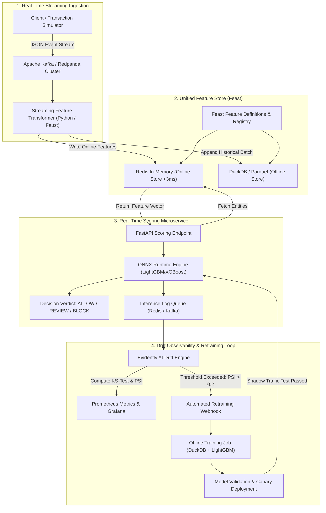
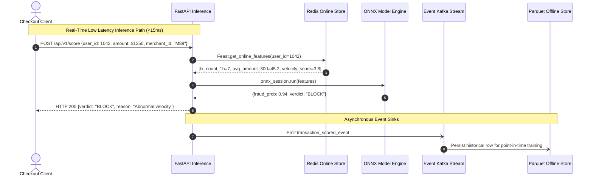

# System Architecture & Technical Specification
## StreamShield-MLOps: Real-Time Event-Driven MLOps Pipeline

---

### 1. High-Level Architecture Flowchart

---

### 2. Feature Store Architecture: Eliminating Train-Serve Skew

---

### 3. Mathematical Foundations of Drift Detection

#### A. Kolmogorov-Smirnov (KS) Test for Numerical Data Drift
To determine whether an incoming feature distribution $F(x)$ differs significantly from the baseline training distribution $F_0(x)$, we compute the supremum statistic:

$$D_{n, m} = \sup_{x} |F_n(x) - F_{0, m}(x)|$$

Under the null hypothesis $H_0: F(x) = F_0(x)$, if the p-value $< 0.05$, the feature is flagged as statistically drifted.

#### B. Population Stability Index (PSI) for Concept & Output Drift
Used to evaluate whether the distribution of model output probabilities or bucketed features has shifted:

$$\text{PSI} = \sum_{k=1}^{B} \left( P_k - B_k \right) \times \ln\left( \frac{P_k}{B_k} \right)$$
Where:
- $B_k$: Proportion of transactions falling into bin $k$ during baseline reference.
- $P_k$: Proportion of transactions falling into bin $k$ during the current evaluation window.

**Action Thresholds:**
- $\text{PSI} < 0.10$: No significant change; model is healthy.
- $0.10 \le \text{PSI} \le 0.20$: Moderate shift; trigger diagnostic inspection.
- $\text{PSI} > 0.20$: Severe concept drift; trigger automated retraining immediately.

---

### 4. Technical Stack Manifest

| Component | Technology | Rationale |
| :--- | :--- | :--- |
| **Streaming Broker** | Redpanda / Apache Kafka | High-throughput distributed message bus, 100% Kafka API compatible. |
| **Feature Store** | Feast 0.40+ | Industry-standard open-source feature store supporting dual Redis/Parquet backends. |
| **Online Storage** | Redis 7+ (Alpine) | Sub-3ms P99 key-value lookup for high-frequency entity features. |
| **Offline Storage** | DuckDB + Apache Parquet | Columnar zero-copy OLAP query engine for historical point-in-time training joins. |
| **Inference Engine** | ONNX Runtime (C++ backend with Python bindings) | 3.5x faster inference latency than native Python XGBoost. |
| **Drift Engine** | Evidently AI + SciPy | Comprehensive statistical drift and data quality reporting. |
| **Metrics & Alerting** | Prometheus + Grafana | Standard SRE observability stack for p99 latency and drift metrics. |
