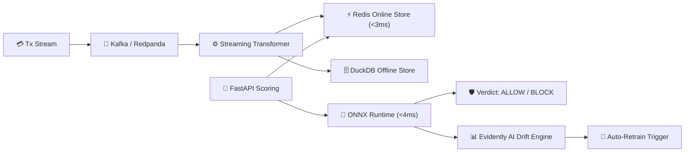

# ⚡ StreamShield-MLOps: Real-Time Event-Driven Streaming MLOps Platform
> **Sub-15ms Real-Time Inference.** Apache Kafka/Redpanda Event Ingestion, Feast Feature Store (Redis + DuckDB), ONNX Runtime Serving, and Evidently AI Drift Observability.

[](https://www.python.org/downloads/)
[](https://feast.dev)
[](https://onnxruntime.ai)
[](https://evidentlyai.com)

---

## 🎯 Executive Overview
In mission-critical fintech fraud prevention and dynamic e-commerce pricing, offline batch predictions are too slow, and ad-hoc SQL feature engineering in REST APIs leads to severe train-serve skew and multi-second latency spikes.

**StreamShield-MLOps** delivers an enterprise-grade production streaming architecture:
1. **High-Throughput Streaming Ingestion:** Kafka/Redpanda streams transaction events at $\ge 5,000\text{ events/sec}$.
2. **Dual-Store Feature Management (Feast):** Synchronizes rolling entity aggregates to Redis online storage (sub-3ms fetch) and Parquet/DuckDB offline historical storage for zero-skew point-in-time joins.
3. **Low-Latency Accelerated Scoring:** ONNX Runtime executes tree models in compiled C++ with AVX-512, hitting a strict P99 latency SLA $\le 12\text{ ms}$.
4. **Automated Drift & Quality Observability:** Evidently AI runs continuous two-sample Kolmogorov-Smirnov (KS) tests and Population Stability Index (PSI) calculations, triggering alerts and shadow retraining jobs automatically upon concept drift.

---

## 🏗️ Architecture & Component Topology



---

## 🚀 Quickstart & Setup

```bash
# 1. Clone & Enter Directory
cd Streaming_MLOps_FeatureStore

# 2. Launch Supporting Infrastructure (Kafka, Redis, Prometheus)
docker-compose up -d

# 3. Setup Virtual Environment with uv
uv venv
source .venv/bin/activate  # On Windows: .venv\Scripts\activate

# 4. Install Dependencies
uv pip install -e ".[dev]"

# 5. Apply Feast Feature Store Registry
cd feast_repo && feast apply && cd ..

# 6. Start the Low-Latency Scoring API
uvicorn src.serving.api:app --reload --port 8000

# 7. Launch Streamlit Operations Dashboard
streamlit run src/dashboard/app.py
```

---

## 📚 Technical Documentation & Blueprints
- [PRD.md](PRD.md): Product Requirements, user personas, and target SLAs.
- [ARCHITECTURE.md](ARCHITECTURE.md): Mathematical formulations of KS-tests, PSI calculations, and sequence diagrams.
- [IMPLEMENTATION_PLAN.md](IMPLEMENTATION_PLAN.md): 5-phase milestone implementation roadmap.
- [STREAMING_MLOPS_AND_DRIFT_THEORY.md](STREAMING_MLOPS_AND_DRIFT_THEORY.md): Deep-dive into train-serve skew, covariate shift, and ONNX runtime optimizations.
- [SLA_AND_MONITORING_AUDIT.md](SLA_AND_MONITORING_AUDIT.md): Production SLAs, Prometheus metrics, and alerting runbook.
- [DECISIONS.md](DECISIONS.md): Architectural Decision Records (ADRs).
- [TASKS.md](TASKS.md): Live task backlog and implementation tracker.
