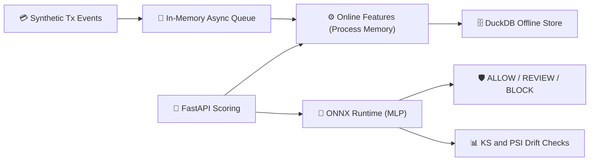

# ⚡ StreamShield-MLOps: Fraud Scoring with ONNX Runtime and Drift Monitoring
> A single-machine fraud-scoring pipeline on synthetic events: rolling online features, DuckDB offline storage, ONNX Runtime inference through FastAPI, and statistical drift checks.

[](https://www.python.org/downloads/)
[](https://onnxruntime.ai)
[](https://duckdb.org)
[](https://fastapi.tiangolo.com)

---

## 🎯 What Is Implemented

1. **Event stream:** an in-memory asynchronous queue and a synthetic transaction generator with a simulated botnet mode.
2. **Feature store:** rolling per-user and per-merchant features in process memory, with historical rows written to DuckDB.
3. **Model serving:** a scikit-learn scaler and MLP classifier exported to ONNX and served through FastAPI.
4. **Drift checks:** per-feature Kolmogorov-Smirnov tests and Population Stability Index (PSI) on fraud scores.
5. **Dashboard:** a Streamlit operations view.

**Design only, not implemented in `src/`:** Kafka or Redpanda, Feast, Redis, Evidently AI, Prometheus, and automated retraining. They appear in the design documents below as a target architecture.

---

## 🏗️ Architecture



---

## 📊 Measured Results

Reproduce with `python scripts/measure_serving.py`. Full output for seeds 42, 7, and 123 is in [`reports/serving_benchmark.json`](reports/serving_benchmark.json). Timings come from in-process calls on one laptop CPU and exclude HTTP and network time.

| Measurement | Result across three seeds |
| :--- | :--- |
| ONNX model call, P50 | 0.045-0.052 ms |
| scikit-learn model call, P50 | 0.243-0.277 ms |
| Median P50 speedup | about 5.3x |
| Fraud score PSI, stable window | 0.050-0.069 |
| Fraud score PSI, simulated botnet window | 5.78-6.63 |

**Known limitations**

- `status` reports `ALERT_DRIFT_DETECTED` on the stable window too, because KS flags two features there. The likely cause is that rolling per-user features keep growing as history accumulates, and this has not been fixed.
- `merchant_risk_score` is computed from labels, including the current event's. This is target leakage, so this repository does not report fraud-detection accuracy.
- Offline batch writes were faster than row-by-row writes in every run, but the speedup varied too widely (5.5x to 181x) to quote as one number.

---

## 🚀 Quickstart & Setup

```bash
# 1. Enter the directory
cd Streaming_MLOps_FeatureStore

# 2. Set up a virtual environment with uv
uv venv
source .venv/bin/activate  # On Windows: .venv\Scripts\activate

# 3. Install dependencies
uv pip install -e ".[dev]"

# 4. Reproduce the measurements
python scripts/measure_serving.py

# 5. Start the scoring API
uvicorn src.serving.api:app --reload --port 8000

# 6. Launch the Streamlit dashboard
streamlit run src/dashboard/app.py
```

---

## 📚 Design Documents

These documents describe the target architecture and its goals. Latencies and throughput figures in them are design targets, not measurements.

- [PRD.md](PRD.md): Product requirements and target SLAs.
- [ARCHITECTURE.md](ARCHITECTURE.md): KS-test and PSI formulations, plus sequence diagrams.
- [IMPLEMENTATION_PLAN.md](IMPLEMENTATION_PLAN.md): Milestone roadmap.
- [STREAMING_MLOPS_AND_DRIFT_THEORY.md](STREAMING_MLOPS_AND_DRIFT_THEORY.md): Train-serve skew, covariate shift, and ONNX notes.
- [SLA_AND_MONITORING_AUDIT.md](SLA_AND_MONITORING_AUDIT.md): Target SLAs and monitoring runbook.
- [DECISIONS.md](DECISIONS.md): Architectural Decision Records.
- [TASKS.md](TASKS.md): Task backlog.
