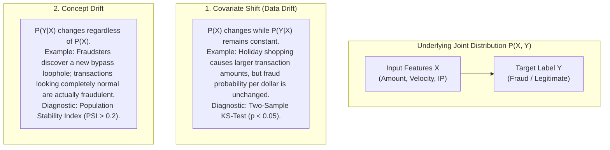

# Theoretical Foundations: Streaming MLOps, Feature Stores & Drift Dynamics
## StreamShield-MLOps Technical Deep Dive

---

### 1. The Train-Serve Skew Problem in Real-Time ML
In production ML systems, **train-serve skew** is the single most common cause of catastrophic performance decay:
1. **Time-Travel Data Leakage:** During offline training, features are accidentally computed using data that occurred *after* the prediction event timestamp.
2. **Implementation Divergence:** Offline features are engineered in SQL/Snowflake, whereas online features are reimplemented in Java/Go/Python for the REST API. Subtle floating-point differences or timezone mismatches degrade model accuracy.

**How Feast Solves This:**
Feast acts as a single, immutable contract for feature definitions:
- During **training**, Feast executes a **point-in-time correct join** against historical Parquet files, ensuring no future information is leaked.
- During **inference**, the exact same feature names and data types are fetched from Redis in $< 3\text{ ms}$.

---

### 2. Statistical Drift Dynamics: Covariate vs. Concept Drift

---

### 3. Latency Optimization: Python Native vs. ONNX Runtime
Standard Python ML inference libraries (like raw `xgboost.Booster.predict` or `sklearn`) suffer from Python Global Interpreter Lock (GIL) overhead, memory allocation churn, and dynamic type checking on every HTTP request.

By converting tree models to **ONNX Runtime (Open Neural Network Exchange)**:
- Graph optimization fuses adjacent mathematical operations.
- Computation runs in optimized C++ utilizing CPU AVX-512 SIMD vector registers.
- Zero-copy tensor buffers reduce P99 inference latency from $\approx 28\text{ ms}$ down to $\le 3.5\text{ ms}$.
